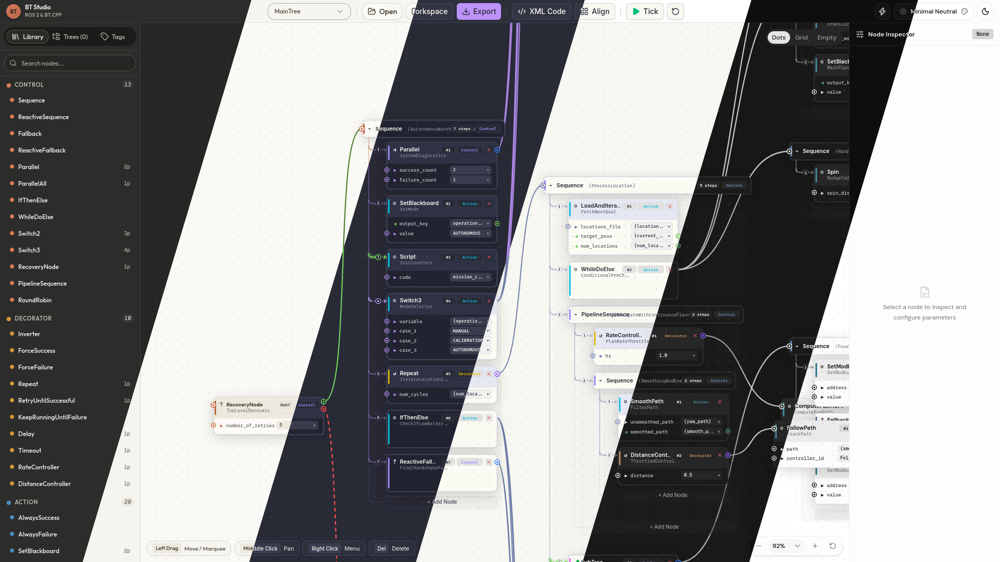

# Behavior Tree Studio

<div align="center">

**Behavior tree visualizer and editor for ROS 2 (Nav2) and BehaviorTree.CPP (v3 / v4) XML formats.**

[](LICENSE)
[](https://docs.ros.org/)
[](https://www.behaviortree.dev/)
[](https://pnpm.io/)
[](https://vercel.com)

<br/><br/>



</div>

---

## Overview

Behavior Tree Studio is an interactive visual editor and viewer for robotics behavior trees built on **BehaviorTree.CPP** and **ROS 2 Navigation2 (Nav2)**. 

The application presents execution hierarchies on a horizontal canvas (left-to-right), exposing execution order, fallback paths, and blackboard port wiring directly. It operates in three environments:
1. **VS Code Extension:** Native preview and editing directly inside the editor (`Ctrl+Shift+V` / `Cmd+Shift+V` on `.xml` files).
2. **Web Application:** Standalone browser-based studio deployed with Vite.
3. **Desktop Application:** Native cross-platform desktop application powered by Tauri.

---

## Features

### Node Canvas & Execution Flow
- **Horizontal Hierarchy:** Left-to-right execution flow matching tree traversal order and branch priority.
- **Explicit Execution Sockets:** Control nodes like `RecoveryNode` and `IfThenElse` render distinct Success and Failure sockets to prevent ambiguous connections.
- **Node Semantics:** Leaf nodes (`Action`, `Condition`) enforce tree rules by disallowing child execution connections.
- **Subtree Preservation:** Disconnecting a wire retains the disconnected branch as a floating node group instead of deleting it.
- **Canvas Operations:** Marquee drag selection, multi-node movement, keyboard shortcuts (`Delete`, `Backspace`), middle-click pan, and pinch zoom.

### Blackboard Ports & Data Flow
- **Port Tag Cards:** Interactive drag-to-spawn blackboard cards from node input and output pins.
- **Directional Wiring:** Visual differentiation between input ports (reading from blackboard) and output ports (writing to blackboard).
- **ROS 2 Typing:** Compatible with common robotics data types (`geometry_msgs::msg::PoseStamped`, numeric, string, boolean).
- **Inline Editing:** Direct editing of blackboard keys (e.g. `{target_pose}`) or static fallback values from the canvas.

### Bidirectional XML Synchronization
- **Integrated Code Drawer:** Slide-out XML editor with syntax validation.
- **Two-Way Sync:** Canvas adjustments immediately update the XML tree; code edits compile and refresh the canvas layout upon saving (`Ctrl+S` / `Cmd+S`).
- **AST Validation:** Structural validation identifying schema errors with exact line and column feedback.
- **Cross-Highlighting:** Selecting a node on the canvas navigates to and highlights the corresponding XML element, scoped correctly inside `<BehaviorTree ID="...">` blocks.

### Theming & Display Options
- **Curated Themes:** Multiple light and dark color schemes, including Claude, Dracula, and Minimal neutral modes.
- **Canvas HUD:** Quick-zoom presets (50%, 75%, 100%, 125%, Fit), grid background toggles (dots, lines, empty), and hotkey reference.

---

## Project Structure

This repository is organized as a monorepo:

```text
behavior-tree-viewer/
├── app/                  # Web and desktop visualizer UI (React 19, Vite, D3, Tailwind CSS v4)
│   ├── src/components/   # Canvas layout, nodes, wire routing, navbar, inspector
│   └── src/features/     # XML parsing, AST models, validation, Tauri bridges
├── src/                  # VS Code extension host (TypeScript, Webpack)
│   └── extension.ts      # Webview panel coordinator and editor document synchronization
├── src-tauri/            # Tauri desktop configuration and Rust window runner
├── crates/               # Rust workspace
│   ├── bt-core/          # BehaviorTree parser, AST definitions, and schema validation
│   └── bt-cli/           # "btview" CLI tool for workspace scanning and validation
├── Media/                # Project assets and preview graphics
├── vercel.json           # Web deployment configuration
├── package.json          # Root workspace scripts and dependencies (pnpm)
└── Cargo.toml            # Rust workspace definition
```

---

## Development & Usage

### Prerequisites
- **Node.js** >= 18
- **pnpm** >= 9 (always use `pnpm`, avoid `npm` or `yarn`)
- **Rust & Cargo** (required for desktop Tauri app and `crates/`)

### 1. Web Studio (Vite)

```bash
# Install dependencies
pnpm install

# Start development server
pnpm app:dev

# Build production bundle (outputs to dist-app/)
pnpm app:build
```

### 2. Desktop Application (Tauri)

```bash
# Run desktop development application
pnpm desktop:dev

# Build standalone desktop installer
pnpm desktop:build
```

### 3. VS Code Extension

```bash
# Compile extension host bundle
pnpm run compile

# Watch mode for extension changes
pnpm run watch
```
To test inside VS Code, press `F5` to open the Extension Development Host. Open any Behavior Tree XML file and press `Ctrl+Shift+V` (`Cmd+Shift+V` on macOS) to launch the preview.

### 4. Rust Workspace

```bash
# Build crates
pnpm run rust:build

# Run test suite
pnpm run rust:test
```

---

## Supported Specifications

- **BehaviorTree.CPP v3 and v4** XML schemas.
- Standard control types: `Sequence`, `ReactiveSequence`, `PipelineSequence`, `Fallback`, `ReactiveFallback`, `IfThenElse`, `WhileDoElse`, `Switch2`, `Switch3`, `RoundRobin`, `RecoveryNode`.
- Standard decorator types: `Inverter`, `ForceSuccess`, `ForceFailure`, `Repeat`, `RetryUntilSuccessful`, `KeepRunningUntilFailure`, `Delay`, `Timeout`, `RateController`, `DistanceController`.
- Action & Condition nodes with custom input/output port models.
- Modular subtrees referenced via `<SubTree ID="...">`.

---

## Roadmap

- [x] Horizontal node graph canvas and layout engine
- [x] Blackboard port cards and directional data wiring
- [x] Bidirectional XML editor with live synchronization
- [x] Multi-theme engine (Claude, Dracula, Minimal)
- [x] Native Tauri desktop shell
- [ ] Workspace node definition scanner (`TreeNodesModel`)
- [ ] Cyclic dependency and undefined blackboard key CLI linting (`btview`)
- [ ] Real-time execution telemetry bridge (ZeroMQ / WebSocket for live tick status)

---

## License

This project is licensed under the [MIT License](LICENSE).
